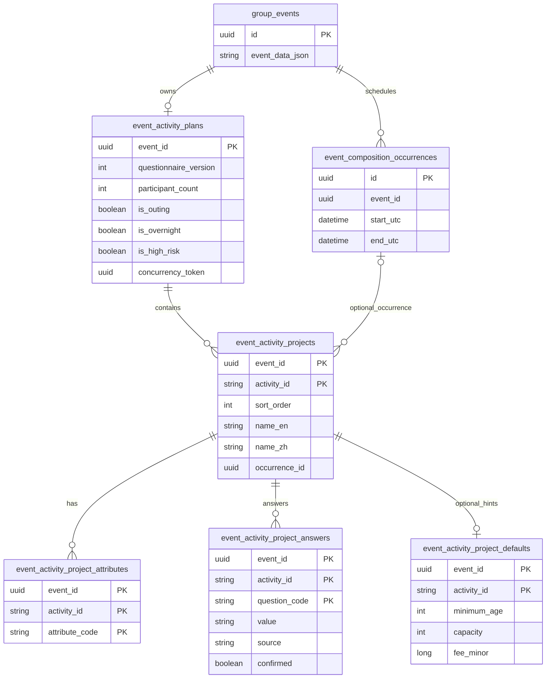
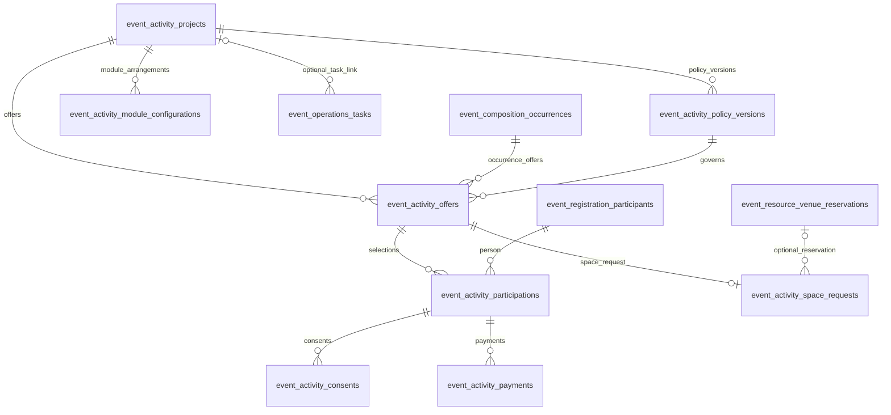

# 活动计划 ER 图与相关表说明

> 核对基准：2026-11-02 的 `main` 源码及 EF 迁移 `20261014031949_RelationalActivityPlans`。图表示代码定义的目标结构，不代表每个部署环境都已应用该迁移。此文档帮助阅读表关系；业务规则仍以 [Event Composition](EVENT-COMPOSITION.md) 和 [机器合同](event-contract.json) 为准。

## 核心活动计划

图中字段是用于识别关系的摘要，并非完整 DDL。`event_activity_plans.event_id` 同时是主键和指向 `group_events.id` 的外键，因此一个 Event 最多有一份当前活动计划，也可以暂时没有。每份计划可有零个或多个项目；项目 ID 是 **Event 内稳定的字符串**，不改为 GUID。项目排序由 `sort_order` 决定。

| 表 | 主键与主要外键 | 作用 |
| --- | --- | --- |
| `group_events` | `id`；关联的 Event 根 | 保存 Event 本身。`event_data_json` 仍是 Event 其他当前业务资料的载体；它不是已移除的活动计划 JSON 列。 |
| `event_activity_plans` | `event_id`，同时指向 `group_events.id` | 当前计划的表头：问卷版本 **2**、预计人数、外出／过夜／高风险标志、双语天气确认、并发标记及更新时间。关系化迁移后不再有 `data_json`。 |
| `event_activity_projects` | `(event_id, activity_id)`；`event_id` 指向计划；可空 `occurrence_id` 指向场次 | 一行对应一个实际活动项目，保存顺序、双语名称与条件、项目时间、来源模板预设键／版本、预设确认状态和是否逐场次重复。来源预设键是溯源资料，**不是**指向模板版本的数据库外键。 |
| `event_activity_project_attributes` | `(event_id, activity_id, attribute_code)`；前两列指向项目 | 项目的独立多选属性。数据库只允许 `hiking`、`water`、`sport`、`transport`、`camp`、`meal`、`outdoor`。没有属性行表示只匹配通用 RAM 检查项；“通用”不是一行可选属性。 |
| `event_activity_project_answers` | `(event_id, activity_id, question_code)`；前两列指向项目 | 每个项目对固定问题的答案，保存 `yes`／`no`／`unknown`、`template`／`human` 来源及 `confirmed` 状态。 |
| `event_activity_project_defaults` | `(event_id, activity_id)`，同时指向项目 | 可选的一行**模板配置提示**：双语资格／条款、年龄、名额、候补、监护同意、费用与币种等。它不是已生效的报名或收费政策。 |
| `event_composition_occurrences` | `id`；`event_id` 指向 Event | 实际场次。项目的 `occurrence_id` 可以为空；关联时服务端还会核对场次归属该 Event。 |

## 项目与运营记录

这里的运营表拥有各自的 GUID 主键。项目政策、场次 offer、模块配置，以及可选的任务项目关联，使用 `(event_id, activity_id)` 外键指向项目，删除动作是 **Restrict／No Action**；因此有这些引用的项目不能直接删除。项目自己的属性、答案和提示子行则随项目删除。一个任务的 `activity_id` 可以为空，此时它是 Event 任务而非项目任务。

| 表 | 与项目的关系 | 作用 |
| --- | --- | --- |
| `event_activity_policy_versions` | 直接引用 `(event_id, activity_id)` | 项目资格、名额、收费等**已配置政策的版本**；与仅作提示的 `event_activity_project_defaults` 不同。保留政策版本与费用审批状态。 |
| `event_activity_offers` | 直接引用项目，同时引用场次和政策版本 | 某项目在某场次的可选报安排；`(event_id, activity_id, occurrence_id)` 唯一，并保存时间和开放状态。 |
| `event_activity_module_configurations` | 直接引用项目，可选引用场次 | 餐饮、交通、住宿等模块在该项目／场次下的独立安排；细节仍存 `details_json`。模块的 Event 级负责人、报告与审批不因此复制成多套。 |
| `event_operations_tasks` | 可选地直接引用项目 | 活动工作台的任务；`activity_id` 为空时仅属于 Event，非空时受项目外键约束。 |
| `event_activity_participations` | 经 `offer_id` 间接关联项目 | 某位报名参与者对某项目场次的选报、席位、资格与锁定费用；另有政策／收费政策版本引用。 |
| `event_registration_participants` | 被项目选报引用 | Event 报名中的参与者身份；同一人可选不同项目 offer。私密生日证据另存于 `event_participant_private_data`，不属于公开活动计划。 |
| `event_activity_consents` | 经 `participation_id` 间接关联项目 | 对具体项目参与记录的监护同意及其政策版本证据。 |
| `event_activity_payments` | 经 `participation_id` 间接关联项目 | 该项目参与记录对应的人工收款、退款等金额与凭证。 |
| `event_activity_space_requests` | 经唯一 `offer_id` 间接关联项目 | 某项目场次的外部空间申请或内部预订关联；`reservation_id` 可选。 |
| `event_resource_venue_reservations` | 由空间申请可选引用 | 内部场地预订及冲突管理记录；它不替代项目或场次。 |

## 容易混淆的边界

- `event_activity_template_versions` 保存**模板的预设项目**，不是已创建 Event 的实际项目表。创建 Event 时复制成 `event_activity_projects` 的独立项目；后来修改模板不会改写该 Event。项目的预设来源字段只用于追溯。
- `event_plan_snapshots`、`event_ram_assessments`／`event_ram_revisions` 和 `event_packages` 保存各自的方案、风险评估与审批上下文，其中历史快照仍可包含 JSON。它们不是 `event_activity_plans.data_json` 的替代表；当前活动计划从上面的关系表重建为原有 `ActivityPlanData` API 形状。
- `questionnaire_version = 2` 是活动项目问卷版本；Event composition 的 `schemaVersion = 2.0.0` 是另一项契约版本。两者没有因关系化而重置。
- 关系化迁移只建结构、不搬迁旧项目数据。若目标库仍有 Event 实例或相关运营记录，迁移会在删除旧计划 JSON 列之前失败；是否已应用须按具体环境核对。

结构依据：[实体定义](../../backend/src/Alife.Domain/Entities/EventActivityPlan.cs)、[EF 关系配置](../../backend/src/Alife.Infrastructure/Persistence/AlifeDbContext.Ram.cs)、[关系化迁移](../../backend/src/Alife.Infrastructure/Persistence/Migrations/20261014031949_RelationalActivityPlans.cs)、[项目运营映射](../../backend/src/Alife.Infrastructure/Persistence/AlifeDbContext.ActivityOperations.cs)。
